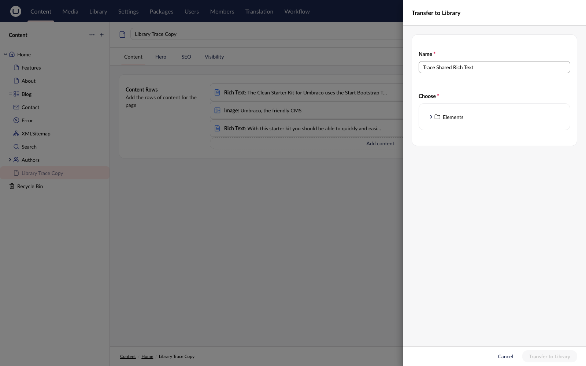
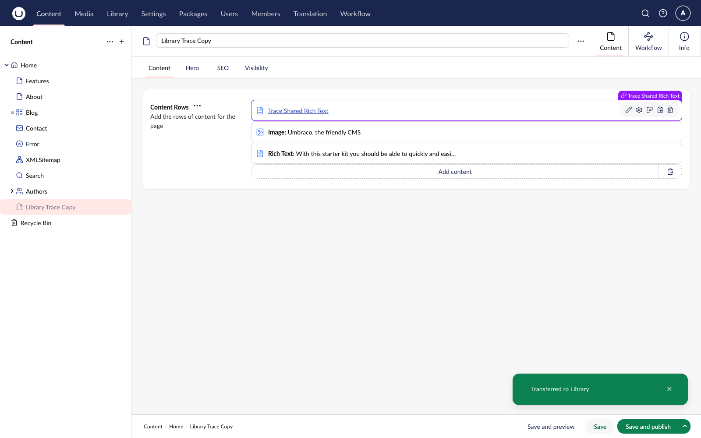
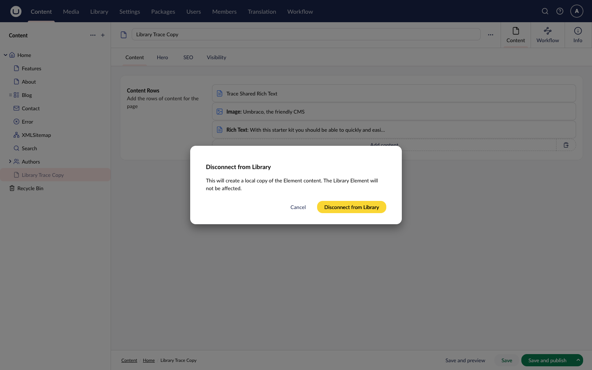

# Library blocks (Umbraco 19): back-office flow trace

Umbraco 19 lets a block on a page link to a reusable **Library Element** instead of holding its own content. `@umbraco-cms/mcp-dev` 19.0.0-beta.1 added the CMS tools `transfer-document-block-to-library` and `disconnect-document-block-from-library`, and a `libraryElementId` option on `create-document-block`. This note records how a human editor does each step in the back office, so the editor tools mirror that flow rather than the raw CMS tool signatures.

## How this was traced

- **Live:** Playwright (system Chrome, `ignoreHTTPSErrors`) against the demo site on Umbraco.Cms 19.0.0-rc1, logged in as admin.
- **Fixture:** a throwaway copy of Clean's "About" page. Clean's `richTextRow` element type was flipped to `allowedInLibrary` in the worktree's own database. No real content was touched.
- **Source:** the back-office code at tag `release-19.0.0-rc1`, under `src/Umbraco.Web.UI.Client/src/packages/block/block/`: `action/common/transfer-to-element-library`, `action/common/disconnect-from-element-library`, `modals/transfer-to-element-library`, `modals/block-catalogue`, and `context/block-manager.context.ts`.

## Transfer to Library

**Entry point.**
- It is a block action on a local block, shown in the action bar next to Edit / Settings / Copy / Delete.
- It is only shown when:
  - the block is not read-only,
  - the block is not already a Library block, and
  - the block's **element type has `allowedInLibrary`** (condition `block-entry-is-allowed-in-library`).
- Clean's element types don't have it, so the action is absent on a stock demo site.

**The modal asks for two things.**
- **Name.** Required. It is prefilled with the block's label, e.g. `Rich Text: The Clean Starter Kit…`.
- **Location.** Required. The editor must explicitly choose the Library root ("Elements") or a folder. The location is checked for create+publish permission and for whether the element type is allowed there.
- Submit stays disabled until both are set.

**Sequencing.**
1. A new Element is created from the block's values, in all the cultures the block holds data in.
2. It is published in the cultures the block is exposed in.
3. The block's content entry is removed and its layout entry is swapped to `{ contentKey: <elementId>, isExternalContent: true }`. Position and settings are kept.
4. The page itself is not saved until the editor saves.

**End state and feedback.**
- The block is drawn as a purple, linked entry labelled with the Element's name.
- One of three toasts appears:
  - "Transferred to Library"
  - "Transferred to Library as draft"
  - "Transferred to Library, but not published". On validation errors, a dialog offers "Open Element".

**Editor tool: `transfer-block-to-library`**
- **Inputs:** `name` is required. `parentFolderId` is optional and defaults to the Library root. `publish` defaults to true, as the back office does.
- **Element-type check:** the tool checks `allowedInLibrary` itself, because the chained CMS tool doesn't. This keeps it from doing something the back office never offers.
- **Output:** the message reproduces the three toast outcomes.
- **Saving:** the chained tool saves the page as a draft, the same as clicking Save afterwards.

## Disconnect from Library

**Entry point.** A block action on a Library-linked block.

**Confirmation.** A warning dialog: *"This will create a local copy of the Element content. The Library Element will not be affected."*

**Sequencing.**
1. The Element's current values are copied into a new local block with a new key.
2. The layout entry is pointed at that block and `isExternalContent` is cleared. Position and settings are kept.
3. The block is exposed.
4. The Element is left alone.

**End state.** A normal local block that offers "Transfer to Library" again.

**Editor tool: `disconnect-block-from-library`**
- **Confirmation:** `requestApproval` with the same wording.
- **Input:** `elementId`, as listed by `inspect-blocks`. A `layoutKey` can be used instead when one Element is placed more than once.
- **Output:** the new local `contentKey`, for `edit-block`.

## Add an existing Element (the "Add block" dialog's Library view)

**Entry point.** "Add content" opens the block catalogue. It has a **Library** view when any allowed block type is Library-enabled (`libraryAllowedElementTypeKeys`).

**Inputs.** Pick one Element from the Library tree or search. Only Elements of allowed types can be selected.

**Result.** A layout entry `{ contentKey: <elementId>, isExternalContent: true }` at the chosen position. No content is copied.

**Editor tool: `add-library-block`**
- Supports BlockList, BlockGrid (span and area options) and Rich Text.
- The output flags an unpublished Element, because its block won't render until the Element is published.

## Reading Library blocks: `inspect-blocks` / `inspect-element-blocks`

**The gap.** A Library-linked block has a layout entry but **no `contentData` entry**. Before this change, the inspect tools only walked `contentData`, so a transferred block was invisible to the LLM.

**The fix.**
- Both tools now return `libraryBlocks` per property, with `elementId`, `layoutKey` and `settingsKey`.
- Each entry is enriched with the Element's name, element type and publish state through one `get-element-batch` call.
- `libraryBlocks` is omitted when a property has none, so existing outputs are unchanged.

**Related.** `delete-block` can now remove a Library block, including inside Rich Text. It removes only the placement; the Element stays in the Library.

## Multilingual

These rules come from `block-transfer-variants.function.ts` and `block-manager.context.ts` at `release-19.0.0-rc1`.

**Language access (transfer).**
- The back office refuses a transfer when the block holds content in a language the user can't edit: "This Block has content in languages you do not have access to: …".
- It also refuses when a culture-variant block has shared content and the user lacks `hasAccessToInvariantForVariant`: "It has shared content that you do not have access to edit."
- The chained CMS tool checks neither, so `transfer-block-to-library` ports the rule as `getBlockedTransferVariants` in `helpers/library-blocks.ts`, using `get-user-current`. It is pinned by unit tests, because the integration API user can access every language.

**Cultures (transfer).**
- A culture-variant Element gets every language the block has content in.
- It is published in the languages the block is *shown* in (its expose entries).
- An invariant element type gives one invariant variant, published if the block is shown at all.
- The tool reports `published` as "published everywhere the block is shown", and returns `elementVariants` with each language's state.

**Cultures (disconnect).** The local copy carries every language of the Element and is shown in the languages the Element is published in.

**Reading state.**
- `inspect-blocks` reports `elementVariants` (per language) for a culture-variant Element, and a single `state` only for an invariant one.
- `add-library-block` checks the Element against the page's languages (or the `culture` passed) and lists any `unpublishedCultures`, where the block won't render yet.

**Integration fixture.** The block-level variance shape:
- a culture-variant host page whose BlockList property is shared,
- a culture-variant, Library-enabled element type,
- a second language. It reuses an existing one, else adds `nb-NO`, the same convention as the translation tests.

## Settings are local

- A Library Element holds a block's **content only**.
- The placement's settings stay on the page: the layout entry keeps its `settingsKey`, and the `settingsData` entry stays in the page's value.
- This holds through transfer and through disconnect, in BlockList, BlockGrid and Rich Text. Each page, and each placement, that uses an Element can have its own settings.

How the editor tools handle this:
- **`add-library-block`** takes `settingsValues` for the new placement. Without them, the back office and the CMS tool create an empty settings entry when the block type has settings.
- **`edit-block` with `blockType: "settings"`** edits a Library block's settings, looked up by the Element id.
- **`edit-block` on a Library block's content** returns an error pointing to `edit-element` (shared content) or `disconnect-block-from-library` (a local copy), because that content isn't on the page.
